# CS-464 Game Development (Lab 07)

* **Student Name:** Mustafa Fawwaz
* **Roll Number:** BSSE23036
* **Target Resolution:** 1920 x 1080 (Landscape)
* **Demo Video:** https://drive.google.com/file/d/1I_BJdRU0LaARfjyegU6DdjLYyd4X66_y/view?usp=sharing

## Screens

### 01. `TitleScreen`
| Annotated Colour | Greyscale |
| :---: | :---: |
| 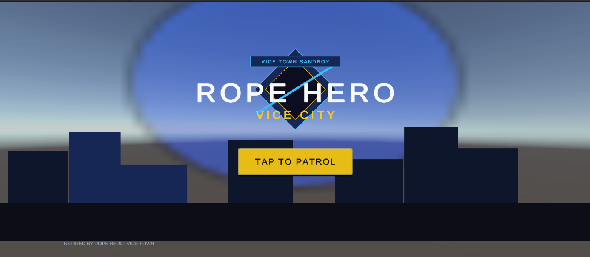 | 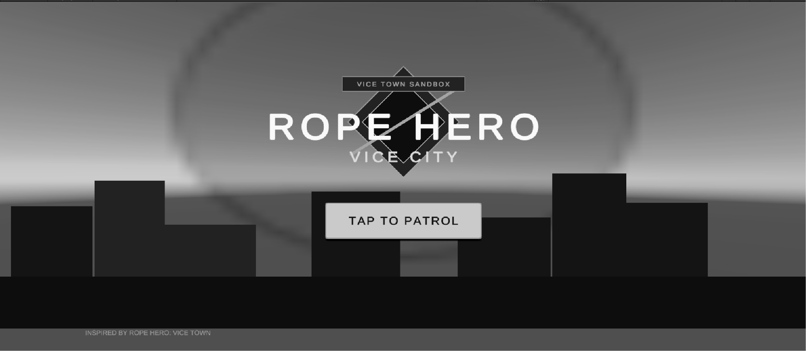 |

---

### 02. `MainMenuScreen`
| Annotated Colour | Greyscale |
| :---: | :---: |
| 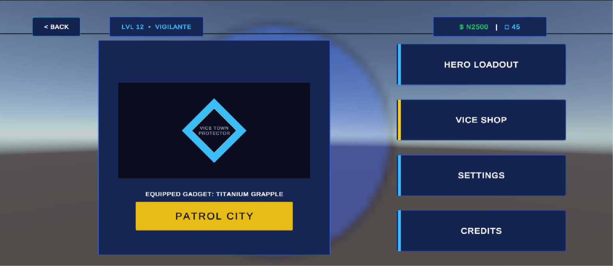 | 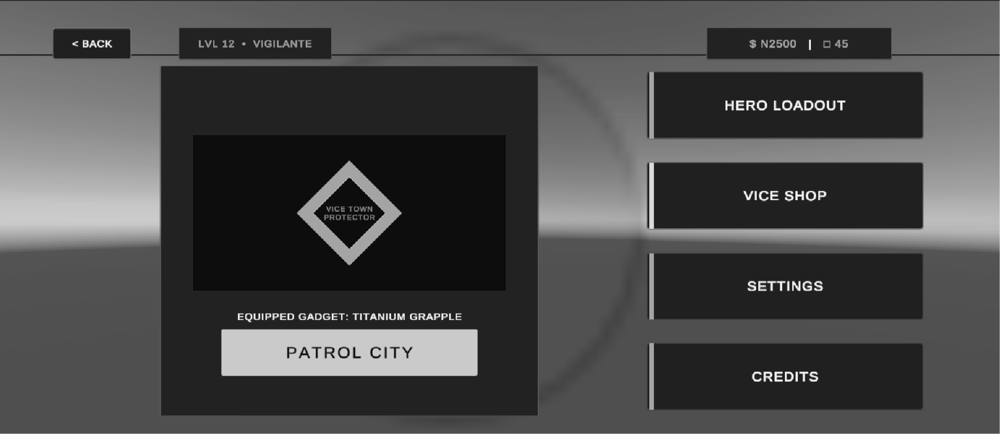 |

---

### 03. `ModeSelectScreen`
| Annotated Colour | Greyscale |
| :---: | :---: |
| 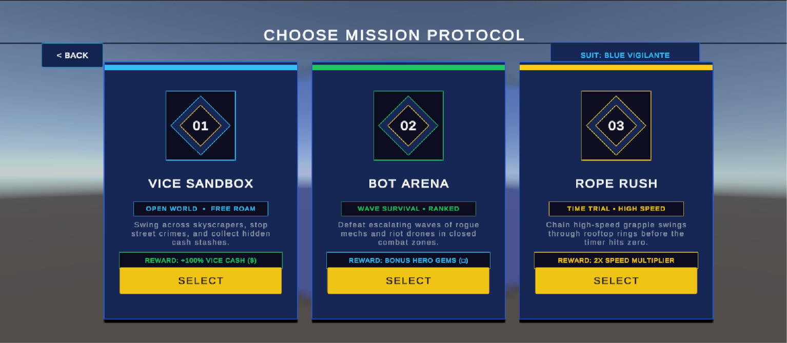 | 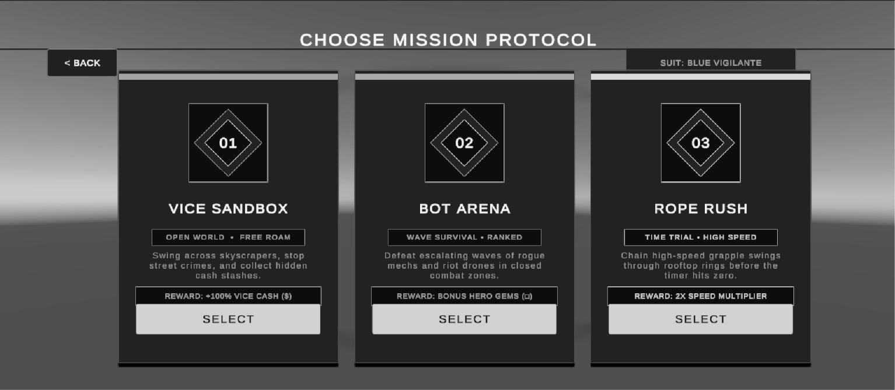 |

---

### 04. `LevelSelectScreen`
| Annotated Colour | Greyscale |
| :---: | :---: |
| 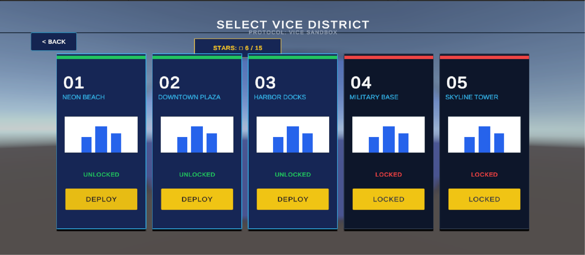 | 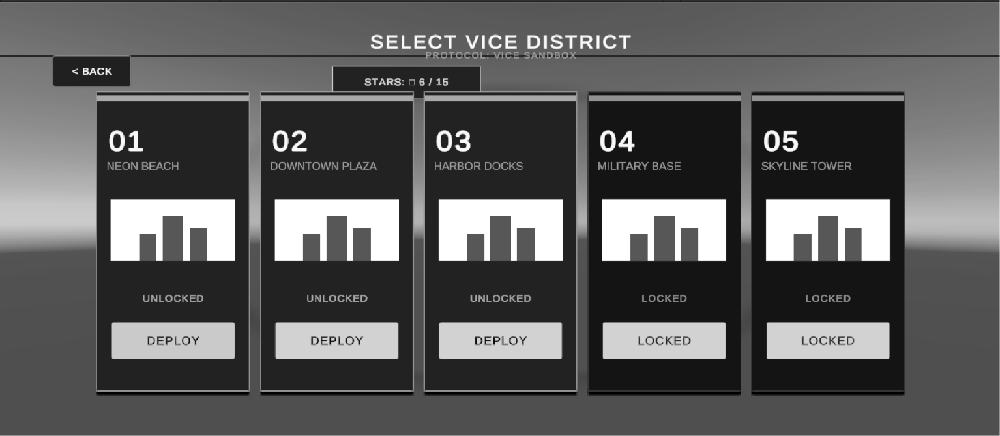 |

---

### 05. `LoadoutScreen`
| Annotated Colour | Greyscale |
| :---: | :---: |
| 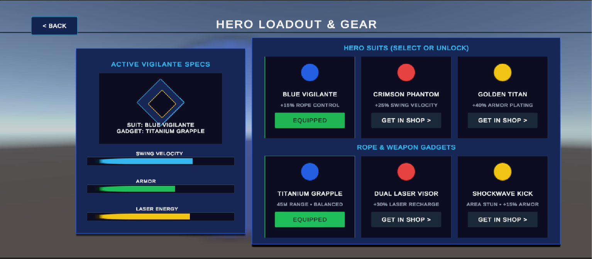 | 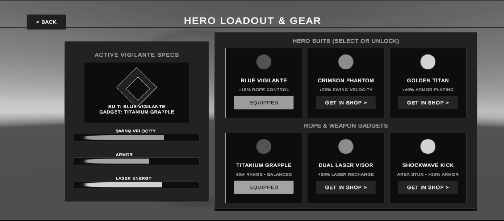 |

---

### 06. `ShopScreen`
| Annotated Colour | Greyscale |
| :---: | :---: |
| 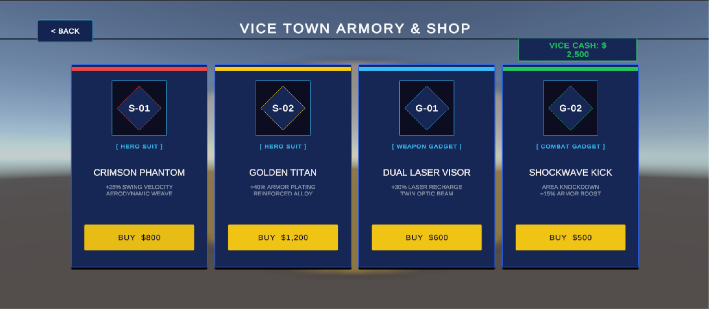 | 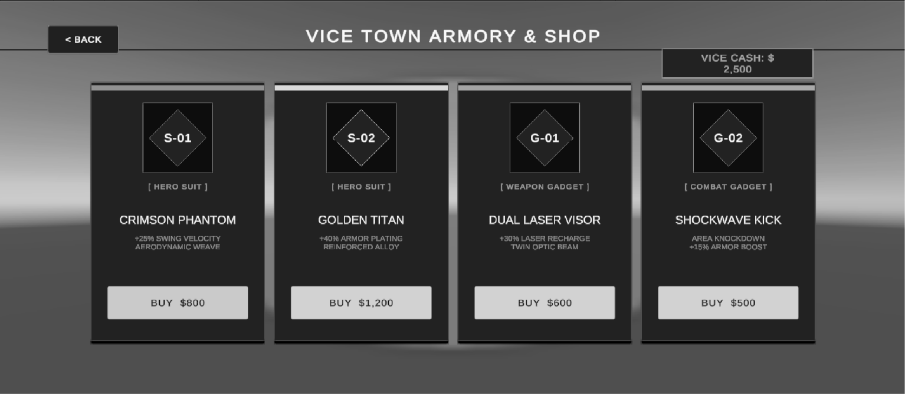 |

---

### 07. `SettingsScreen`
| Annotated Colour | Greyscale |
| :---: | :---: |
| 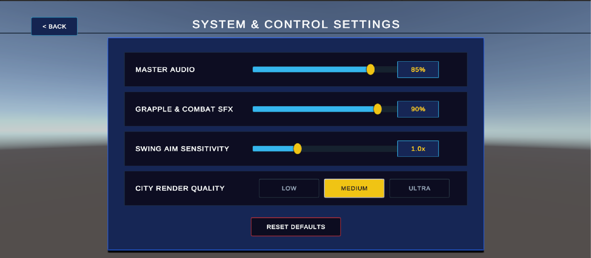 | 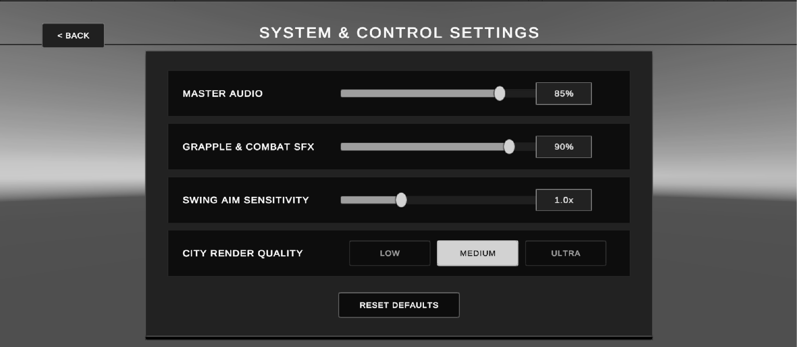 |

---

### 08. `GameplayScreen`
| Annotated Colour | Greyscale |
| :---: | :---: |
| 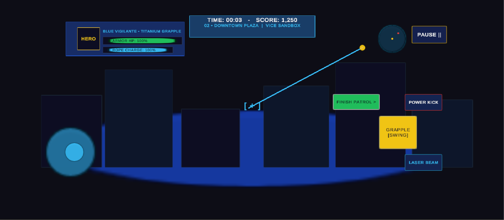 | 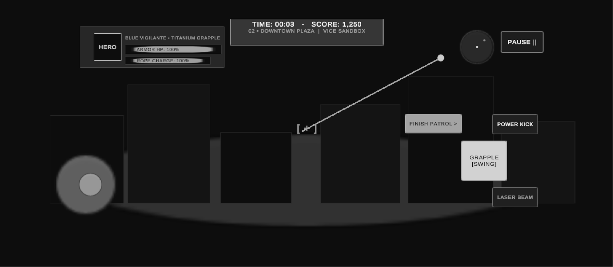 |

---

### 09. `PauseScreen`
| Annotated Colour | Greyscale |
| :---: | :---: |
| 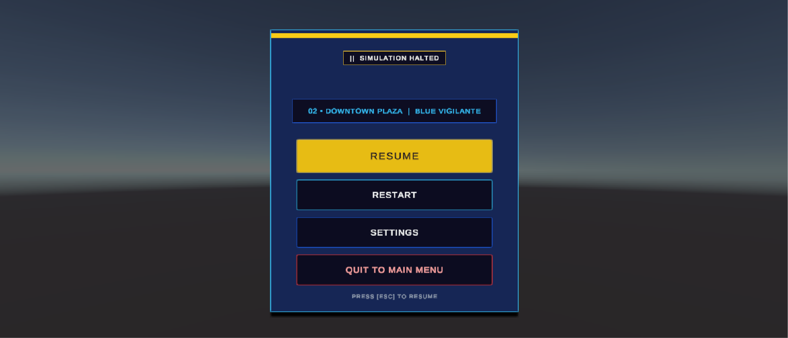 | 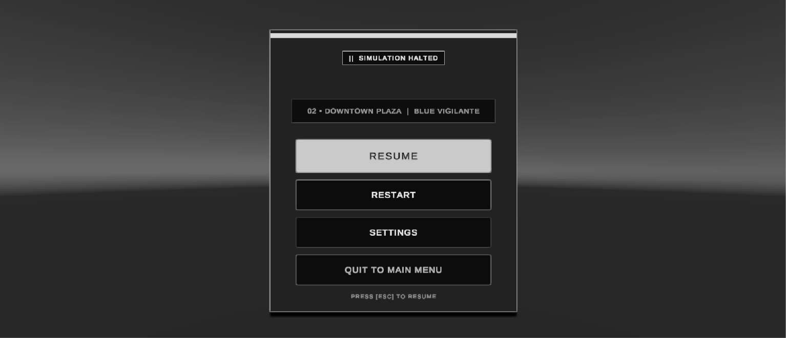 |

---

### 10. `ResultsScreen`
| Annotated Colour | Greyscale |
| :---: | :---: |
| 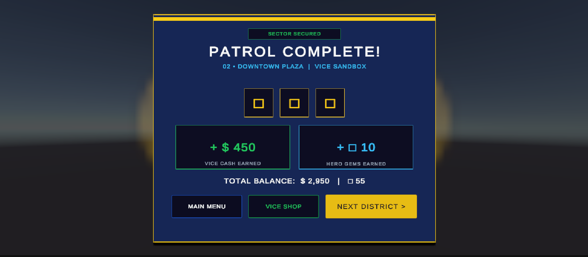 | 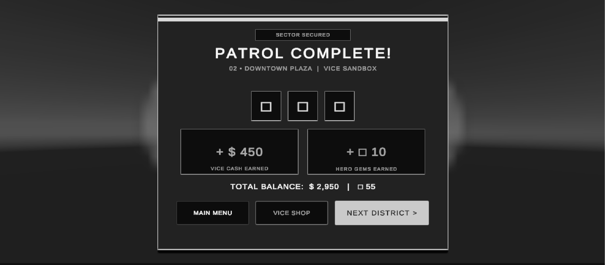 |

---

### 11. `CreditScreen`
| Annotated Colour | Greyscale |
| :---: | :---: |
| 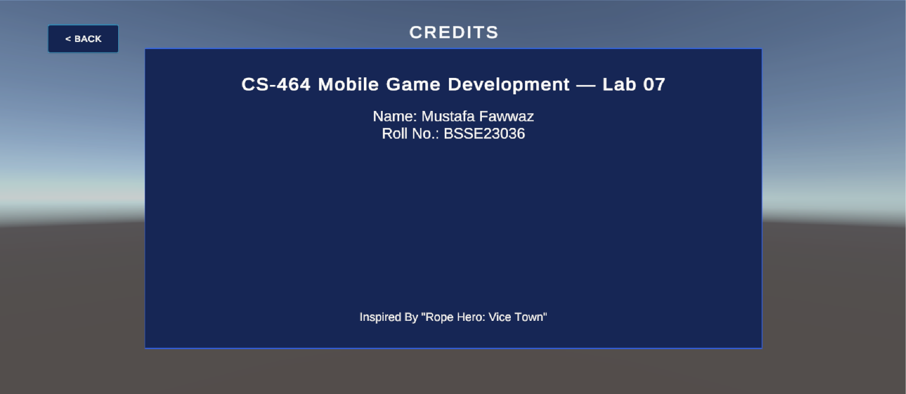 | 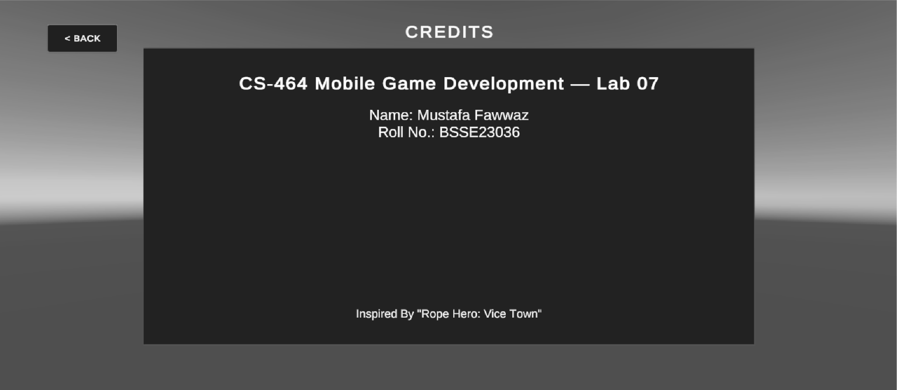 |

---

## Setup & Run Instructions

1. Clone this repository and add the project folder in **Unity Hub**.
2. Open the project using **Unity `6000.3.24f1`**.
3. Open the main scene inside `Assets/Scenes/` and set the **Game** view resolution to **`1920x1080`**.
4. Press **Play** to navigate through all 11 screens.

---

## Credits & References

* **Game Inspiration:** *Rope Hero: Vice Town* (Naxeex Action & RPG Games)
* **Assets & Tools:** Built natively in Unity `6000.3.24f1` using uGUI primitives, TextMeshPro (`LiberationSans SDF`), and custom C# scripts.